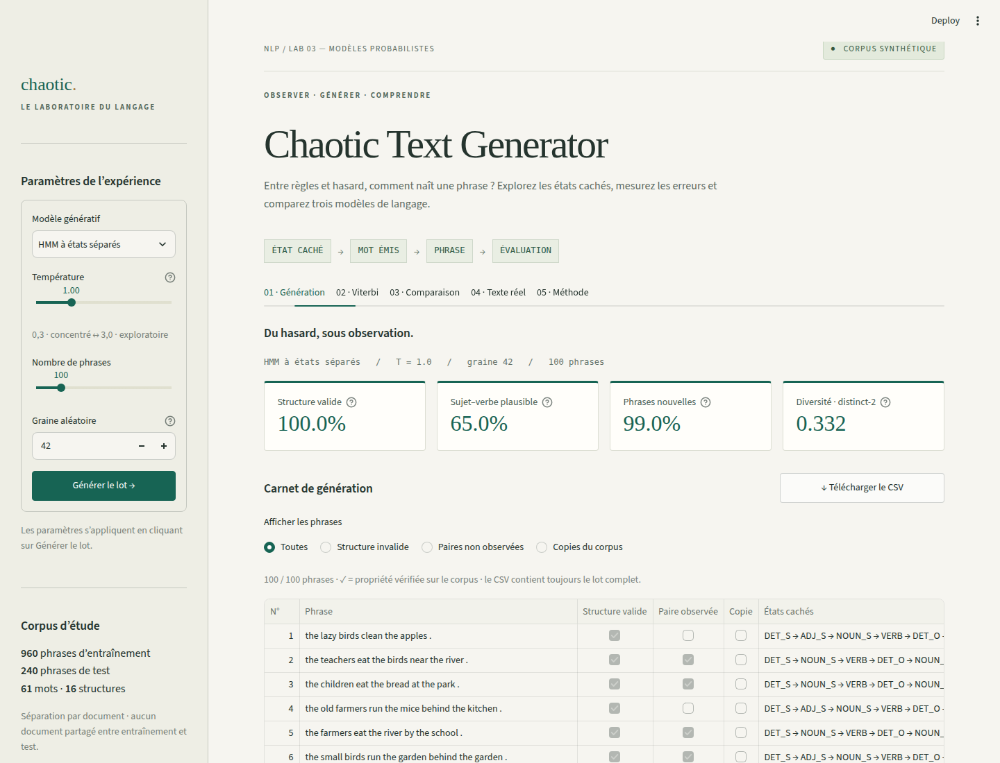

# Chaotic Text Generator

**Lab 03 · Traitement automatique du langage · Master SDIA**

Ahmed Douyry

Une application Streamlit pour générer des phrases, examiner leurs états cachés et comparer trois modèles : HMM classique, HMM à états séparés par rôle et trigramme. Un second outil analyse une phrase avec Viterbi, mot par mot.

[Rapport illustré](report/rapport.pdf) · [Synthèse d’une page](report/rapport_synthese.pdf) · [Déploiement](DEPLOYMENT.md)

> **Application publique :** URL à renseigner après déploiement sur Streamlit Community Cloud.



## Démarrage

Python 3.11 ou 3.12. Depuis le dossier contenant `app.py` :

```bash
python3 -m venv .venv
source .venv/bin/activate
python -m pip install -r requirements.txt
python -m streamlit run app.py
```

Ouvrir http://localhost:8501. Le corpus, les résultats d’évaluation et les rapports sont inclus : l’application ne télécharge aucune donnée au démarrage. Sous Windows, activer l’environnement avec `.venv\Scripts\activate`.

## Utilisation

1. Choisir un modèle, une température, une graine et un lot de 10 à 500 phrases, puis cliquer sur **Générer le lot**.
2. Examiner les quatre métriques, filtrer les échecs et télécharger le lot complet en CSV.
3. Dans **Viterbi**, saisir une phrase anglaise pour afficher ses tags. Les mots inconnus déclenchent un avertissement.
4. Dans **Comparaison**, comparer les modèles aux mêmes paramètres et explorer l’effet de la température.
5. Consulter **Texte réel** pour les résultats EWT et **Méthode** pour le protocole et le rapport.

Les états affichés pour les HMM sont ceux échantillonnés pendant la génération. Le trigramme n’a pas d’états cachés : ses tags sont inférés ensuite avec Viterbi. Les suffixes de rôle S/O/P sont retirés pour mesurer la validité structurelle.

## Résultats

Séparation par document : **960 phrases d’entraînement / 240 de test**. Chaque modèle est évalué sur **500 phrases**, avec une graine de **42**. À température **T = 1,0** :

| Modèle | Structure valide | Sujet–verbe observé | Phrases nouvelles | Distinct-2 |
|---|---:|---:|---:|---:|
| HMM classique | 16,2 % | 14,8 % | 99,8 % | 0,198 |
| HMM à états séparés | 100 % | 60,6 % | 99,4 % | 0,148 |
| Trigramme | 57,0 % | 76,0 % | 91,2 % | 0,105 |

La séparation des états restaure les structures de la petite grammaire, mais ne garantit pas le sens. Sur le corpus réel **UD English EWT**, le HMM atteint **88,04 %** de précision, contre **86,16 %** pour le tag majoritaire et **100 %** sur le synthétique. Sa précision sur les mots inconnus est de **28,21 %**.

La capture ci-dessus utilise un lot de **100 phrases** : ses valeurs diffèrent donc de celles du tableau. Distinct-2 dépend de la taille du lot.

## Reproduire et vérifier

```bash
# Évaluation synthétique : 3 modèles, 4 températures, 500 phrases par lot
python -m src.evaluate

# Évaluation réelle : téléchargement EWT au premier lancement
python -m src.evaluate_real

# Tests du modèle, des exports et de l’application
python -m unittest discover -s tests -v

# Génération des deux PDF et de leur source Markdown
python -m pip install -r requirements-report.txt
python -m src.build_report
```

L’évaluation EWT nécessite Internet au premier lancement, puis utilise `data/ewt/`, exclu de Git. La révision du corpus, les effectifs et les empreintes SHA-256 sont consignés dans [ewt_results.json](results/ewt_results.json). Les résultats mesurés peuvent légèrement différer des valeurs indicatives du guide (88,1 %).

## Organisation

```text
app.py                 Application Streamlit
assets/                Styles de l’interface
src/                   Modèles, évaluations et génération du rapport
data/                 Corpus synthétique et script de génération
tests/                Tests automatisés
results/              Mesures et journaux d’exécution
report/               Rapport, synthèse et classification des échecs
screenshots/          Captures de génération, Viterbi et version mobile
```

## Documents à remettre

| Élément | Accès |
|---|---|
| Dépôt avec code, corpus et README | [GitHub](https://github.com/ahmed-douyry/-chaotic-text-generator) |
| Application publique | À déployer — voir [DEPLOYMENT.md](DEPLOYMENT.md) |
| Rapport illustré : synthèse + deux annexes | [rapport.pdf](report/rapport.pdf) |
| Rapport strictement limité à une page | [rapport_synthese.pdf](report/rapport_synthese.pdf) |
| Deux captures demandées | [Génération](screenshots/01-generation-desktop.png) · [Viterbi](screenshots/02-viterbi-desktop.png) |

Le guide exige une page de rapport : utiliser la synthèse pour cette remise, avec les captures en pièces séparées. Le rapport illustré rassemble les mêmes éléments dans un seul document.

## Données et limites

Le corpus synthétique contient 1 200 phrases, six catégories grammaticales et seize patrons d’entraînement. Les métriques sont définies relativement à ce corpus ; elles ne mesurent pas la qualité de l’anglais réel. Un couple sujet–verbe absent du corpus n’est pas nécessairement absurde. La nouveauté ne prouve pas la créativité, et un générateur peut reproduire des phrases d’entraînement.

Les données réelles proviennent de [Universal Dependencies English EWT](https://github.com/UniversalDependencies/UD_English-EWT), annotations © Stanford et contributeurs sous [CC BY-SA 4.0](https://creativecommons.org/licenses/by-sa/4.0/). Révision utilisée : `491be069d36e378f67c29f183699eea88308ea42`. Le prétraitement met les mots en minuscules et exclut les lignes multi-tokens et les nœuds vides. L’évaluation porte sur un seul corpus anglais et ne garantit pas les performances dans un autre domaine.
