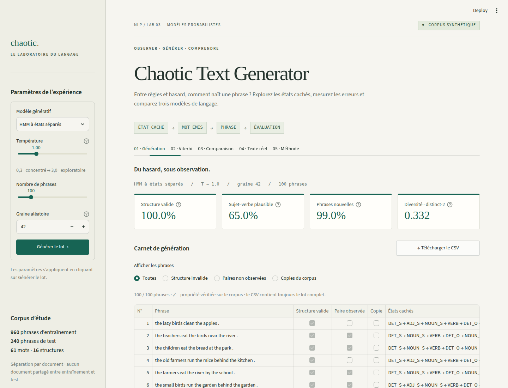
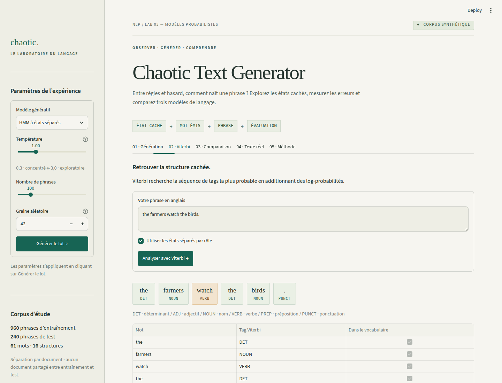

# Lab 03 — Chaotic Text Generator

Ahmed Douyry · Master SDIA · 11 novembre 2026

## Problème et solution

Générer une phrase ne suffit pas à prouver sa qualité : il faut mesurer structure, plausibilité et diversité. Le HMM estime des probabilités de départ, de transition et d’émission par comptage. Le trigramme utilise les deux mots précédents avec repli. Une application Streamlit compare les trois générateurs, affiche leurs états et exporte les lots. Viterbi retrouve les tags en espace logarithmique, avec lissage add-k (k = 0,01).

## Protocole et hypothèse

Protocole : séparation par document, 960 phrases d’entraînement et 240 de test ; 500 phrases générées par modèle et température, graine 42. Hypothèse : les états séparés devraient maximiser la validité structurelle. Les 10 premières phrases et les occurrences de watch sont consultables dans l’application ; watch est correctement étiqueté 37/37 fois au test.

| Modèle | Structure valide | Sujet–verbe | Nouveauté | Distinct-2 |
| --- | --- | --- | --- | --- |
| HMM classique | 16,2 % | 14,8 % | 99,8 % | 0,198 |
| HMM à états séparés | 100,0 % | 60,6 % | 99,4 % | 0,148 |
| Trigramme | 57,0 % | 76,0 % | 91,2 % | 0,105 |

## États séparés : apport et limites

Le HMM classique oublie si un nom est sujet ou objet : après NOUN, les probabilités VERB ≈ 0,39, PREP ≈ 0,22 et PUNCT ≈ 0,39 se mélangent. Les états S/O/P séparent ces rôles et restaurent les 16 patrons de la petite grammaire (100 % à T = 1). Ils ne modélisent pas le sens : seulement 60,6 % des couples sujet–verbe sont observés, contre 76,0 % pour le trigramme. Nouveauté et distinct-2 ne prouvent ni créativité ni correction.

## Température et usages

Jouet d’écriture : HMM à états séparés, T = 1,5 pour varier les mots en gardant une structure valide. Autocomplétion : trigramme, T = 0,5 pour privilégier les suites fréquentes ; sa validité baisse de 63,6 % à 44,2 % entre T = 0,5 et 2,5, tandis que distinct-2 augmente entre ces extrêmes (0,095 → 0,112), sans monotonie stricte. Le prix d’une température basse est davantage de répétitions et de copies.

## Exemples et causes des échecs

Exemple satisfaisant : « the children eat the bread at the park . » — patron valide, couple observé et phrase nouvelle ; cela reste un indicateur limité du sens. Limite sémantique : « the lazy birds clean the apples . » — patron valide mais couple sujet–verbe non observé (ce qui ne prouve pas une absurdité) : les émissions ne sont pas conditionnées par le sujet. Structure : un HMM classique peut terminer après le sujet. Mémorisation : « the girls leave the park . » est recopiée par le trigramme (T = 0,5).

## Du synthétique au réel

Le test réel utilise 12 544 phrases d’entraînement et 2 077 de test, 17 tags et 10 359 patrons, contre 6 tags et 16 patrons synthétiques. Les mots inconnus représentent 7.5% des tokens. Le HMM gagne 1.88 points sur la baseline, mais ne réussit que 40.4% des phrases entières. Pour un inconnu, k/(effectif du tag + kV) favorise les tags rares (X, INTJ) : la précision OOV reste faible. La métrique des 16 patrons ne se transpose pas à EWT. La mesure actuelle (88.04%, contre 88,1 % indicatif dans le guide) dépend de la révision du corpus ; le modèle ne garantit rien sur un autre domaine.

| Corpus / modèle | Précision | Connus | Inconnus | Phrase correcte |
| --- | --- | --- | --- | --- |
| Synthétique / HMM + Viterbi | 100,0 % | 100,0 % | sans OOV | 100,0 % |
| EWT / tag majoritaire | 86,16 % | 90,83 % | 28,59 % | 31,87 % |
| EWT / HMM + Viterbi | 88,04 % | 92,89 % | 28,21 % | 40,39 % |

Source EWT : https://github.com/UniversalDependencies/UD_English-EWT · CC BY-SA 4.0 · révision 491be069d36e378f67c29f183699eea88308ea42. Les résultats sont relatifs aux corpus ; ils ne mesurent pas la qualité de l’anglais réel.

## Annexe — Captures de l’application

### Figure 1 — Génération et mesure du lot

HMM à états séparés, T = 1,0, graine 42, 100 phrases. La capture montre les quatre indicateurs, les filtres, les états cachés et l’export CSV. Les scores (100 % de structures valides, 65 % de couples observés, 99 % de nouveauté, distinct-2 = 0,332) portent sur ce lot de démonstration ; le tableau de synthèse utilise 500 phrases. Distinct-2 dépend notamment de la taille du lot.

### Figure 2 — Décodage Viterbi mot par mot

Phrase analysée : « the farmers watch the birds. ». Le mot ambigu watch reçoit ici le tag VERB ; la ponctuation est séparée des mots. Le tableau indique l’appartenance au vocabulaire. Cette capture illustre une phrase connue, pas le traitement des inconnus : celui-ci est vérifié séparément par les tests automatisés.
